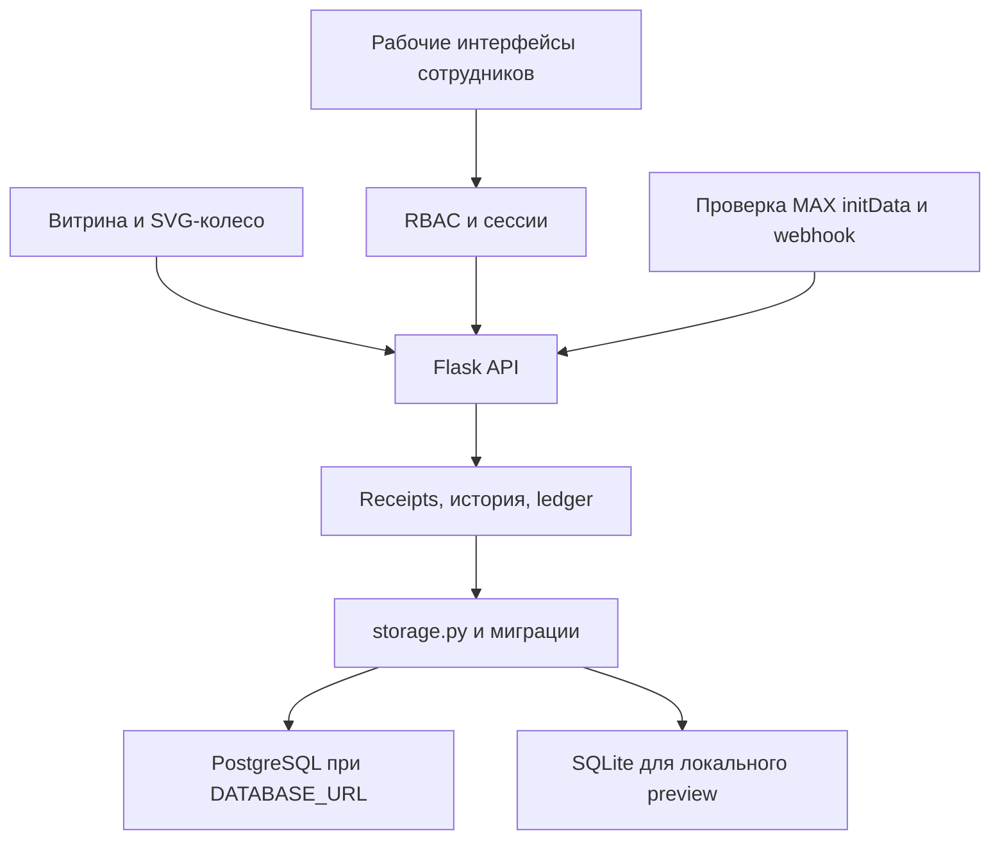
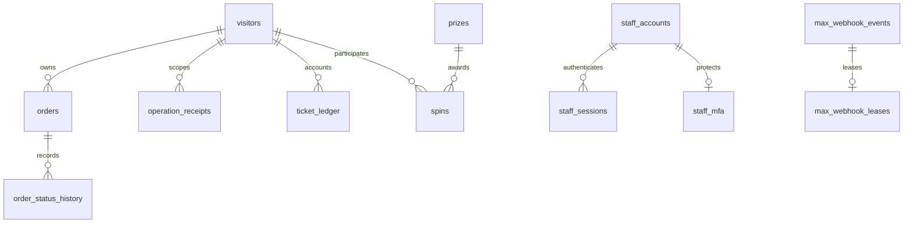

# РАКОВАРЪ — поставка P0

Проверка: 9 ноября 2026, московское время. Этот документ описывает реализованный этап и имеет приоритет над восстановленными историческими roadmap-документами.

## Результат и совместимость

Существующий Flask backend сохранён. Реализованы PostgreSQL через `DATABASE_URL`, проверяемые миграции, индивидуальный доступ сотрудников, серверный RBAC, отзыв сессий, TOTP, идемпотентные тестовые заказы/вращения, история статусов и тематическое SVG-колесо. Коммерческий checkout остаётся закрыт. P1–P3 не объявляются готовыми.

Рабочая ветка `work/rakovar-p0-foundation-20261109` основана на `fix/rakovar-seafood-homepage-v6` (draft PR #1), чтобы сохранить исправления каталога и фотографии. `main` не перезаписывается. Исходный ZIP сохранён как исторический пакет, но сборка его не использует.

Два API требуют нового заголовка `Idempotency-Key`: `/api/orders`, `/api/game/spin`. Известные потребители — storefront и tests — обновлены. Повтор передаёт тот же ключ и точное JSON-тело. Другие внешние клиенты должны пройти миграцию по [контрактам](API_OVERVIEW.md).

## Архитектура реализованного этапа



Это модульный переход от существующего монолита, без смены публичного стека. Отказ PostgreSQL не приводит к незаметному переходу на SQLite. Legacy-операции пока сериализуются общей транзакционной блокировкой. Это обеспечивает корректность текущих read/modify/write сценариев, но ограничивает пропускную способность; переход к блокировкам отдельных строк и отдельным сервисам бизнес-логики относится к следующему этапу.

## Связи данных



Диаграмма показывает логические связи. В legacy-схеме не все они ещё оформлены внешними ключами; bootstrap owner `bootstrap` хранится отдельно от `staff_accounts`, поэтому session/staff связи не являются строгими FK. Нормализация состава заказов из JSON, складские партии и клиентская CRM — P1.

## Матрица готовности

| Контур | Статус | Реальная граница |
|---|---|---|
| Обычные исходники, повторяемая сборка | TESTED | Повторный build не меняет UI; отсутствующие файлы дают ошибку |
| PostgreSQL/SQLite, миграции | TESTED | Настоящий локальный PostgreSQL 17.11; Render ещё не переведён |
| Backup/restore и preview-transfer | TESTED | `pg_dump → pg_restore`, сверка данных/миграций; перенос только synthetic preview в пустую БД |
| Сотрудники, роли, сессии | TESTED | Отдельные учётные записи, блокировка, роли, серверный отзыв |
| TOTP MFA | TESTED | Enrollment, подтверждение, защита повторного кода; шифрование seed и recovery ещё нужны |
| Идемпотентные order/spin | TESTED | Receipt и эффект в одной транзакции, конфликт тела даёт 409 |
| Статусы и сторнирование | TESTED | Демонстрационная схема, оплаченный заказ можно отменить после подготовки; отдельная платёжная модель ещё нужна |
| Тематическое колесо | TESTED | Серверный сектор, original SVG, звук opt-in, лёгкий/reduced motion; только тестовые призы |
| Рефералы и билеты | TESTED | Ledger и отмена исходных начислений; промышленный антифрод ещё отсутствует |
| MAX webhook lease/retry | TESTED | Незавершённое событие не ACK как успешный duplicate; реальная доставка/мобильный MAX не проверены |
| Административный UI | IMPLEMENTED | Рабочие API проверены; общий браузерный E2E запускается отдельно |
| Склад, FEFO, движения, резервы | DESIGNED | Сейчас редактируется технический preview stock; складской системы ещё нет |
| Курьерские назначения/маршруты | DESIGNED | Роль создана, рабочего кабинета доставки ещё нет |
| CRM и согласия реальных клиентов | DESIGNED | Preview намеренно отбрасывает контактные поля |
| Медиабиблиотека/object storage | DESIGNED | Загрузка и прикрепление файлов ещё не реализованы |
| Эквайринг/фискализация | BLOCKED | Нет согласованного коммерческого подключения |
| Автопубликация VK/MAX/Telegram | BLOCKED | Реальные publisher adapters отсутствуют, ручной published запрещён |
| Производственный запуск | BLOCKED | Нужны P1, инфраструктура, материалы/правила компании и приёмка |

## Обнаруженные и закрытые ошибки

- Чужой MAX ID можно было присвоить без initData; анонимный запрос больше не может использовать этот namespace.
- Новый браузер мог присвоить существующий guest ID. Теперь требуется подписанная cookie; утраченная гостевая сессия начинает новый профиль, MAX восстанавливается проверенной авторизацией.
- Повтор SKU обходил проверку общего остатка. Повторяющиеся строки отклоняются.
- Повтор заказа/вращения после потери ответа создавал вторую операцию. Введены ключи и атомарные receipts.
- Лимит промокода и конкурсный draw имели гонки. Контексты сериализованы, изменения состояния выполняются условно.
- Отмена `paid → preparing → cancelled` не сторнировала билеты. Сторнируются точные исходные ledger суммы независимо от промежуточного статуса.
- Редактор мог выставить `published` без интеграции. Этот статус больше не доступен через ручной PATCH.
- Незавершённый webhook после crash считался обработанным duplicate. Добавлена lease; повтор незавершённого запроса остаётся retryable.
- Розыгрыш конкурса был доступен до окончания последнего дня. Заявки принимаются по `ends_at` включительно в Europe/Moscow.
- HTTP 409 приходил HTML вместо ожидаемого JSON. Для API сохранены корректные HTTP статусы и JSON ошибки.
- Backend позволял создать больше призов, чем поддерживает колесо. Создание/активация ограничены 32 секторами; legacy-конфигурация сверх лимита блокируется до списания билета.

## Инструкции проверки

```bash
python -m venv .venv
.venv/bin/python -m pip install -r requirements-dev.txt
.venv/bin/python prepare_render.py
.venv/bin/python scripts/validate_preview.py
.venv/bin/python -m pytest -q
.venv/bin/python scripts/run_postgres_tests.py --postgres-bin /path/to/postgresql/bin -- -q --tb=short
node --check static/storefront.js
node --check static/admin.js
node --check static/staff.js
node --check static/wheel.js
```

Для браузерного acceptance: установить `requirements-browser.txt`, выполнить `python -m playwright install chromium`, затем `python scripts/browser_check.py --app-python .venv/bin/python --output docs/qa`. Скрипт запускает отдельный Gunicorn со случайными тестовыми паролями и временной БД; удалённый адрес ему передать нельзя. В CI есть отдельные validate, postgres и browser jobs.

Проверенные данные и команды приведены в `docs/qa/verification.json` и в истории CI. В текущей изолированной среде отдельный запуск Chromium заблокирован системным запретом создания Unix socket; скрипт не объявлен прошедшим на основании этого запуска. Через общий браузер проверены реальная витрина, вращение/баланс и создание synthetic-заказа; сохранены JPG. Перехват потери ответа и полный staff UI относятся к отдельному browser job.

## Эксплуатационные ограничения

Бесплатный Render preview проверен через API: `rakovar-preview-0psh`, Frankfurt, `main`, `/api/health`, auto-deploy on commit; на момент начального аудита live commit `2a8f52c2ec6053b467c294144f3872327991f742`. Наличие live deploy не подтверждает актуальность новой ветки. Платные ресурсы, реальные БД, токены и production не менялись.

Переход на постоянный PostgreSQL Render выполняется отдельно, после создания/выбора разрешённой базы, резервной копии, dry-run, реального восстановления и приёмки. Настройка `DATABASE_URL` в коде не означает, что постоянная БД уже подключена в Render.

Контакты, ассортимент, состав/аллергены, тарифы, права на фотографии и публичные формулировки бренда наследуются из имеющегося preview и требуют подтверждения компании. При текущем аудите прямое чтение VK и clients.site через поисковый инструмент было недоступно; новые факты о компании не добавлялись. Юридическая проверка рекламных сообщений, персональных данных и призовых акций до публичного включения остаётся отдельной задачей.

Следующий целостный этап: нормализованные заказы и платёжные события → складские движения/резервы с партиями и FEFO → назначение курьеров/подтверждение доставки → object storage и защищённые вложения. До этого технический stock и отдельная роль courier не означают реализованную ERP/доставку.
