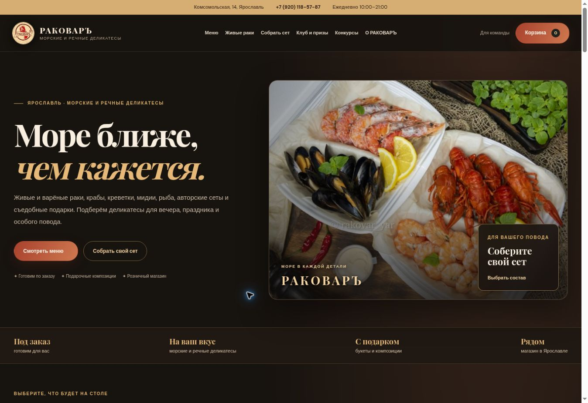

# Публичная версия РАКОВАРЪ — проверка 10 ноября 2026

TESTED / LIVE: https://rakovar-preview-0psh.onrender.com/
Вход: https://rakovar-preview-0psh.onrender.com/admin/login
Конструктор: https://rakovar-preview-0psh.onrender.com/#sets

Render deployment: dep-dbpombec6qcc73e5fh20, status live.
Commit приложения: 88d027cb1273b0931640139b84f5d212397b675c.
CI: https://github.com/milekcat/rakovar-yaroslavl/actions/runs/42904436900
Все три задания (validate, postgres, browser) завершились успешно.
107 тестов SQLite, 119 тестов PostgreSQL, 10 браузерных сценариев;
JavaScript errors: 0. Прямые зависимости: pip-audit, известных уязвимостей нет.
Это не полный аудит всей инфраструктуры или транзитивных зависимостей.

Публичные HTTP-проверки: /api/health — 200, status=ok, database=postgresql;
/api/bootstrap — 200, 69 товаров и 5 размеров живых раков;
/admin/login — 200 с новой брендированной формой;
/api/admin/connections без входа — 401. Содержимое studio.js, connections.js,
meeting.css и XXL-фото побайтно совпадает с проверенным исходным кодом.

В браузере проверены публичная главная, подбор набора для 4 гостей
(3 позиции, 7960 ₽, 1990 ₽/чел.), полный список 69 позиций и страница входа.
Публичный вход с паролем не выполнялся; сценарии входа, MFA и прав проверены
на одноразовой синтетической среде CI. Действующий пароль владельца сохранён
при обновлении. API-ключи компании не вводились, сообщения не отправлялись.

Состояние БД: PostgreSQL 17, бесплатная rakovar-demo-db-20261110, Frankfurt;
доступна; миграция 0004 добавляет три таблицы без удаления данных.
Старые синтетические записи временной SQLite не перенесены. Бесплатная БД
истекает 10 декабря 2026. Автоматический deploy отключён: изменение ветки
само по себе не заменяет показанную заказчику версию.

Ограничения: DEMO_MODE=true, оплата и реальные заказы отключены. Ключи, ID,
права и webhook провайдеров требуют приёмки владельцем. 56 карточек имеют
сопоставленные фото, 13 — фирменные иллюстрации до получения оригиналов.
Цены и наличие требуют подтверждения компании.

