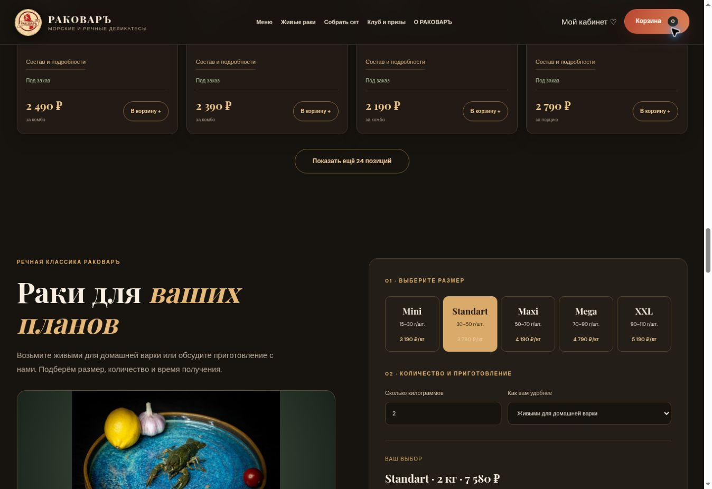

# РАКОВАРЪ — проверенный публичный выпуск 11 ноября 2026

**IMPLEMENTED / TESTED / LIVE.** Функциональная версия магазина опубликована в существующем бесплатном Render-сервисе. Это подтверждение технического выпуска, а не утверждение готовности всех коммерческих условий.

| Раздел | Адрес |
|---|---|
| Магазин и меню | https://rakovar-preview-0psh.onrender.com/#catalog |
| Кабинет покупателя | https://rakovar-preview-0psh.onrender.com/account |
| Отдельный вход сотрудников | https://rakovar-preview-0psh.onrender.com/team/rakovar-control/login |

Commit приложения: `5753065769190f1770e6365dad21592bb3a6972f`.
Render deployment: `dep-dbq5hpu7bikc738k8c4g`, **live**, завершён 11 ноября 2026 в 15:02:10 по Москве.
Сервис: `srv-dbocgktg1s2s73eq6gk0`; план free, Frankfurt. По фактически полученной конфигурации сервис теперь отслеживает `main`, автоматическая публикация включена. Повторный ручной deploy после объединения исправления кеша не запускался.

## Опубликованная реализация

Объединены [магазин, PR №5](https://github.com/milekcat/rakovar-yaroslavl/pull/5) и [исправление кеша, PR №6](https://github.com/milekcat/rakovar-yaroslavl/pull/6). Все ранее открытые PR проекта включены в main; на момент проверки открытых PR нет.

На витрине 59 карточек с положительными ценами и фотографиями, включая пять отдельных размеров живых раков. Неполные позиции исключены из покупательского меню. Реализованы поиск, категории, сортировка, конструктор сетов, избранное, корзина с серверным расчётом, оформление заявки с оплатой при получении, кабинет и история заказов, склад и возврат резерва, промокампании, отдельный бонусный журнал и внутренние уведомления.

Основные файлы магазина: `shop.py`, `app.py`, `staff_auth.py`, `commerce_safety.py`, `data/catalog.json`, `static/storefront.js`, `static/studio.js`, `static/account.js`, `static/shop-admin.js`, `static/admin.js`, `static/shop.css`, шаблоны витрины / кабинета / админки, миграции `0005`–`0007`, тесты и манифесты источников. Подробное описание: [STORE_OPERATIONS_2026-11-11.md](STORE_OPERATIONS_2026-11-11.md).

При публичной проверке выявлен реальный дефект обновления: существующий браузер получал новую HTML-страницу, но повторно использовал старый JavaScript с прежними карточками «По запросу». Заголовок no-cache в новой версии не удалял уже сохранённые ответы старого preview. В `app.py` добавлены версии локальных JS / CSS по SHA-256 содержимого. `tests/test_app.py` проверяет такие адреса на витрине, в кабинете и на служебной странице. После выпуска в том же браузере появились 24 карточки первой страницы без «По запросу», пять цен размеров и новый checkout. Вручную очищать кеш не потребовалось.

## Выполненные проверки

| Проверка | Результат |
|---|---|
| Локальный `pytest -q` после исправления кеша | 124 passed, 12 PostgreSQL-only skipped |
| `scripts/validate_preview.py`, JS syntax и `git diff --check` | PASS |
| [CI точного опубликованного merge commit](https://github.com/milekcat/rakovar-yaroslavl/actions/runs/43016643568) | validate, postgres, browser — success |
| [CI исправления до объединения](https://github.com/milekcat/rakovar-yaroslavl/actions/runs/43016368130) | все три задания — success |
| `/`, `/account`, служебная страница входа | HTTP 200 |
| Анонимные `/admin`, `/admin/login` | HTTP 404 |
| Анонимный `/api/admin/store/orders` | HTTP 401 |
| `/api/store/catalog` | 59 товаров, все цены положительные, 5 размеров раков |
| Фотографии опубликованных товаров | Все 59 уникальных адресов вернули HTTP 200 и тип image |
| Версии CSS / JS на трёх страницах | Все совпадают с хешами исходных файлов |
| `/api/health` | status=ok, database=postgresql, store_checkout=payment_on_receipt |
| Серверный расчёт 1,5 кг Standart + WELCOME10, самовывоз | 5 685 ₽ − 568 ₽ = 5 117 ₽; переданная поддельная цена проигнорирована |
| Браузер: 2 кг Standart + WELCOME10, самовывоз | 7 580 ₽ − 758 ₽ = 6 822 ₽; будущие бонусы 341; адрес скрыт и не обязателен |
| Браузер: кабинет | Заказы, вкладки, бонусные условия 5% / до 20% загрузились |
| Журнал Render после первичного выпуска, фильтр error | Ошибок в запрошенном интервале не найдено |

На публичном сайте тестовый заказ не отправлялся; данные покупателя и пароль не вводились. Сценарии создания / повторной отправки заказа, отмены, склада, ролей и MFA проверяются на одноразовых синтетических SQLite / PostgreSQL и браузерном CI. Вход в публичную админку с действующим паролем владельца **NOT_VERIFIED**; форма настроенного входа открывается.

## Данные и безопасность

Публичный сервис использует существующую PostgreSQL `rakovar-demo-db-20261110`, состояние available. Миграции `0005`–`0007` добавляют таблицы и индексы; деструктивная миграция не выполнялась. Последнее исправление кеша не меняет схему БД или API. Прямая дополнительная SQL-проверка live-схемы через внешний Render MCP недоступна из-за закрытых внешних подключений; сетевой доступ БД не расширялся. Подтверждены запуск приложения с PostgreSQL и успешные миграционные проверки CI.

Включён `HIDE_STAFF_ENTRY=true`. Ссылок на админку в публичном меню нет; покупатели используют свой `/account`. Авторизация, серверные роли, CSRF, разделение покупателей, шифрование контактов, идемпотентность заказов и журналирование сохраняются. Пароли не сбрасывались; секреты в отчёт и Git не включались. Это не полный аудит безопасности инфраструктуры.

## Границы коммерческого запуска

- 15 неполных карточек остаются черновиками админки. Полнота переноса с clients.site не подтверждена; происхождение имеющихся данных сохранено в `docs/research/`.
- Опубликованные цены импортированы и требуют подтверждения компании. Фактические остатки не внесены: товары обозначены «Под заказ» до инвентаризации.
- Онлайн-эквайринг не подключён. Доступно оформление с оплатой при получении.
- Внутренние уведомления реализованы. Внешние каналы MAX / Telegram выключены; реальные ключи, адресат и доставка сообщений не приняты. VK / MAX / Telegram требуют настройки владельцем.
- Подтверждение email и самостоятельное восстановление пароля ещё не реализованы. Внешняя авторизация владельца не проверена.
- Компания должна утвердить доставку, реквизиты, условия акций и лояльности, обработку данных и правила призовых кампаний.
- Текущая бесплатная PostgreSQL истекает **10 декабря 2026**. Постоянный тариф, резервное копирование и проверку восстановления нужно согласовать до коммерческой эксплуатации. Платные ресурсы этим выпуском не создавались.

Следующий шаг для коммерческого запуска: подтвердить каталог и условия, заполнить черновики и фактические остатки, настроить постоянное хранение / backup и принять внешние уведомления; затем подключать онлайн-оплату и почтовое восстановление.

